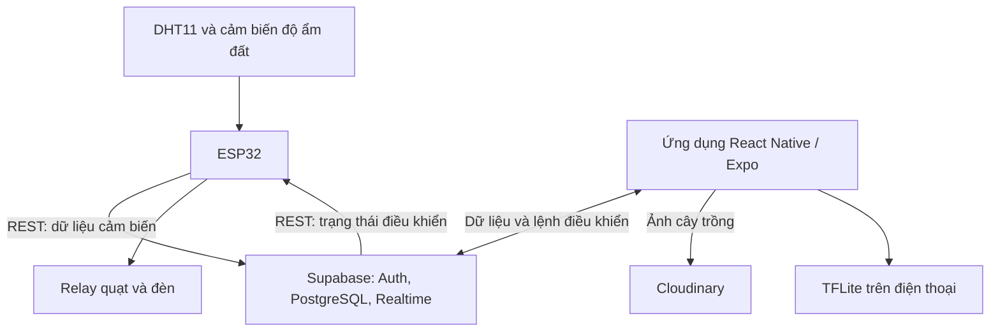
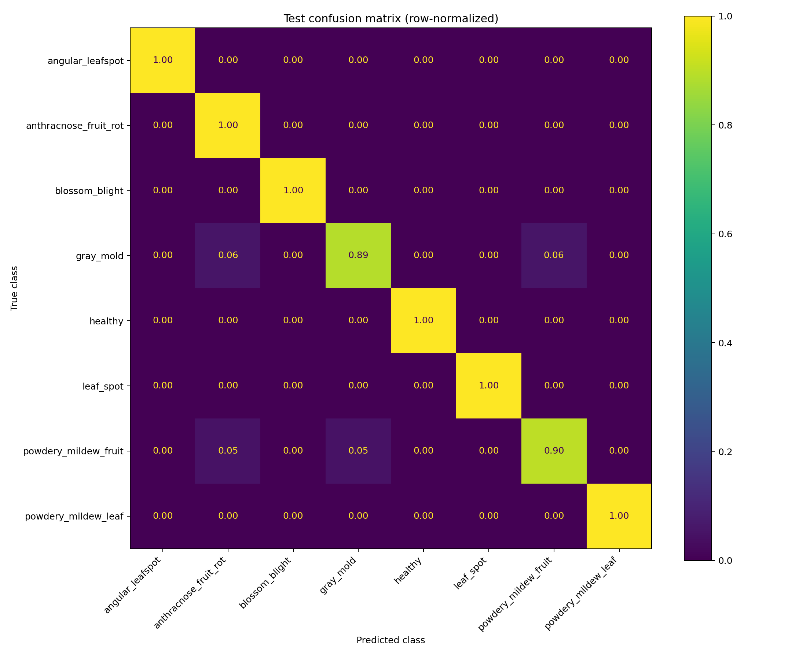

# Strawberry Agriculture App

Hệ thống hỗ trợ chăm sóc vườn dâu, kết hợp **ứng dụng React Native/Expo**, **thiết bị ESP32**, **Supabase** và **AI MobileNetV3-Large**. Dự án hướng đến việc theo dõi môi trường, điều khiển thiết bị và phân loại hình ảnh bệnh trên cây dâu ngay trên điện thoại.

> **Trạng thái repository:** đã có mã nguồn ứng dụng, firmware, notebook huấn luyện và model xuất sẵn. Tuy nhiên, repo chưa có đủ cấu hình để cài đặt và chạy ngay sau khi clone. Xem [Các phần cần hoàn thiện](#các-phần-cần-hoàn-thiện) trước khi triển khai.

## Tính năng

| Thành phần | Chức năng có trong mã nguồn |
| --- | --- |
| Giám sát | Theo dõi nhiệt độ, độ ẩm không khí và độ ẩm đất; biểu đồ 24 giờ và lịch sử 7 ngày, 30 ngày, 3 tháng |
| Điều khiển | Giao diện bật/tắt quạt, đèn, máy bơm; xem 20 bản ghi điều khiển gần nhất |
| Lịch hoạt động | Giao diện tạo lịch theo giờ và ngày cụ thể, bật/tắt hoặc xóa lịch |
| Cây trồng | Thêm thông tin cây, ngày trồng, thuốc, phân bón, ghi chú; tìm kiếm và lưu ảnh qua Cloudinary |
| Nhận diện bệnh | Chụp/chọn ảnh, chạy TFLite trên thiết bị, hiển thị kết quả và 3 lớp có điểm cao nhất |
| Kết nối | Supabase Anonymous Auth, tự tạo/tham gia thiết bị theo `device_code`, cập nhật dữ liệu qua Realtime |
| ESP32 | Đọc cảm biến, điều khiển relay quạt/đèn, cấu hình Wi-Fi qua captive portal, watchdog và cập nhật firmware qua Wi-Fi |

## Kiến trúc



Suy luận AI thực hiện cục bộ. Đồng bộ cảm biến, điều khiển qua Supabase và tải ảnh cây trồng lên Cloudinary cần kết nối mạng. Scanner hiện hiển thị kết quả tại giao diện, chưa ghi kết quả vào bảng `disease_diagnoses`.

## Công nghệ

- **Ứng dụng:** React Native, Expo, TypeScript, `react-native-chart-kit`, `react-native-safe-area-context`.
- **Dữ liệu:** Supabase PostgreSQL, Anonymous Auth, Row Level Security (RLS), Realtime và AsyncStorage.
- **Ảnh:** Cloudinary, Expo Image Picker, Image Manipulator, File System và Asset.
- **AI trên điện thoại:** `react-native-fast-tflite`, `jpeg-js`, `base64-js`.
- **Huấn luyện:** Python, TensorFlow/Keras, NumPy, scikit-learn, Pillow, Matplotlib.
- **Phần cứng:** ESP32, DHT11, cảm biến độ ẩm đất analog và relay; firmware dùng Arduino framework.

## Cấu trúc thư mục

```text
Strawberry_Agriculture_App/
├── Firmware/
│   └── firmware_esp32.cpp         # Cảm biến, relay, Wi-Fi, REST và OTA
├── IntelligentCAM/
│   ├── AI.ipynb                   # Chia dữ liệu, huấn luyện, đánh giá, xuất model
│   └── model_output/              # Keras, TFLite, nhãn, checkpoint và báo cáo
├── Report/
│   ├── bao_cao_AI.pdf
│   ├── bao_cao_mobile.pdf
│   └── silde_mobile.pdf
└── StrawberryApp/
    ├── App.tsx                    # Điều hướng 3 tab
    ├── app.json                   # Cấu hình Expo
    ├── eas.json                   # Profile build development/preview/production
    ├── database.sql               # Schema nền, RLS, Realtime và RPC
    ├── assets/model/              # TFLite FP32/FP16 và nhãn
    ├── components/DiseaseScanner.tsx
    ├── hooks/useDevice.ts
    ├── lib/                       # Supabase, session, xử lý ảnh, kiểu dữ liệu
    └── screens/                   # HomeScreen, ControlScreen, PlantsScreen
```

## Chuẩn bị và cấu hình

### 1. Tải mã nguồn

```bash
git clone https://github.com/timmie182/Strawberry_Agriculture_App.git
cd Strawberry_Agriculture_App
```

Chuẩn bị môi trường Node.js/npm tương thích với Expo SDK của dự án, Supabase project và Cloudinary account. Để chạy bản Android native, cần Android SDK/JDK hoặc môi trường EAS Build. Repo chưa có `package.json` nên chưa xác định được phiên bản Expo/React Native và bộ dependency chính xác.

### 2. Supabase

1. Tạo Supabase project riêng.
2. Chạy [StrawberryApp/database.sql](StrawberryApp/database.sql) trong SQL Editor trên database mới. Script chứa nhiều lệnh `CREATE TABLE`/`CREATE POLICY` nên không phải migration có thể chạy lặp lại nguyên trạng.
3. Bật **Anonymous Sign-ins** để `signInAnonymously()` hoạt động.
4. Cập nhật `SUPABASE_URL` và `SUPABASE_ANON_KEY` trong [lib/supabase.ts](StrawberryApp/lib/supabase.ts).
5. Đặt `DEVICE_CODE` trong [lib/session.ts](StrawberryApp/lib/session.ts), mặc định là `ESP32-001`.
6. Bổ sung các migration còn thiếu trong mục [Các phần cần hoàn thiện](#các-phần-cần-hoàn-thiện), gồm policy và Realtime cần thiết.

Khi mở app, chương trình tạo phiên ẩn danh rồi gọi RPC `join_or_create_device`. RPC tạo thiết bị mới hoặc thêm người dùng vào thiết bị có cùng mã. Vì biết mã là có thể tham gia, cơ chế này cần được gia cố trước khi dùng cho thiết bị thực tế có nhiều người dùng.

**Quyền truy cập của ESP32:** firmware hiện gửi cùng một key qua header `apikey` và `Authorization`, nhưng không đăng nhập để có JWT người dùng. Trong khi đó, RLS trong SQL yêu cầu thành viên thiết bị và chưa cho phép firmware dùng anon key đọc/ghi đầy đủ. Chỉ điền URL/key sẽ chưa đủ; cần triển khai xác thực thiết bị và policy phù hợp, hoặc API trung gian có kiểm tra quyền. Không nhúng `service_role` vào app hoặc firmware phân phối.

### 3. Cloudinary

Trong [PlantsScreen.tsx](StrawberryApp/screens/PlantsScreen.tsx), thay:

```ts
const CLOUDINARY_CLOUD_NAME = '<your-cloud-name>';
const CLOUDINARY_UPLOAD_PRESET = '<your-unsigned-upload-preset>';
```

Luồng hiện tại tải ảnh lên Cloudinary và lưu `secure_url` vào `plant_photos.storage_path`. Hướng dẫn bucket `plant-photos` trong cuối file SQL là phần tham khảo; màn hình cây trồng hiện không tải ảnh lên Supabase Storage.

### 4. Ứng dụng di động

Trước khi chạy, cần khôi phục `package.json`, lockfile và entry point từ dự án gốc, bổ sung cấu hình Metro nhận `.tflite` trong `resolver.assetExts`, đồng thời sửa kiểu `Plant` đang thiếu trong `lib/types.ts`.

Danh sách công nghệ ở trên được xác định từ mã import, không thay thế manifest dependency. Mã scanner đang dùng API v3 của `react-native-fast-tflite`; cần khôi phục các phiên bản và native dependency tương thích. Sử dụng bản build native/development build có module TFLite.

**Sau khi đã khôi phục cấu hình và sửa các phần còn thiếu**, luồng chạy Android dự kiến:

```bash
cd StrawberryApp
npm install
npx expo run:android
```

Repo có sẵn các profile EAS sau:

| Profile | Cấu hình |
| --- | --- |
| `development` | Development client, phân phối nội bộ |
| `preview` | Android APK, phân phối nội bộ |
| `production` | Android App Bundle |

Nếu dùng EAS, kiểm tra lại `extra.eas.projectId` trong `app.json` theo tài khoản/project của bạn. Không có APK build sẵn trong cây mã nguồn hiện tại. Các lệnh build chưa được xác minh chạy thành công từ repo này.

### 5. Firmware ESP32

Mã firmware dùng API watchdog của **ESP32 Arduino core 3.x**. Cần thư viện WiFiManager (tzapu), DHT sensor library (Adafruit) cùng dependency và ArduinoJson; các thư viện Wi-Fi, Preferences, HTTPClient, WebServer, Update đi kèm ESP32 core.

| Thiết bị | GPIO trong firmware |
| --- | --- |
| DHT11 | 4 |
| Cảm biến độ ẩm đất (analog) | 34 |
| Relay đèn | 27 |
| Relay quạt | 26 |
| Nút BOOT/reset cấu hình | 0 |
| LED trạng thái | 2 |

1. Tạo sketch Arduino phù hợp từ [firmware_esp32.cpp](Firmware/firmware_esp32.cpp); repo chưa cung cấp project Arduino/PlatformIO hoàn chỉnh.
2. Cấu hình Supabase và hoàn thiện quyền truy cập thiết bị như phần trên; thay mật khẩu portal/OTA trước khi triển khai.
3. Kiểm tra chân nối và `RELAY_LOW_TRIGGER` theo module relay thực tế; mặc định biến này là `false`.
4. Nạp firmware qua USB, mở Serial Monitor ở **115200 baud**.
5. Kết nối mạng cấu hình `ESP32-VuonDau-Setup`, nhập Wi-Fi và mã ghép nối trùng `DEVICE_CODE` trong app. Thiết bị phải tồn tại trong bảng `devices` trước khi firmware tra cứu.

Firmware đặt chu kỳ gửi cảm biến 10 giây, đọc trạng thái điều khiển 3 giây và heartbeat 15 giây. Chế độ `auto` bật quạt khi nhiệt độ **> 30°C**, tắt khi **< 28°C**, giữ trạng thái trong khoảng giữa. Đèn bật khi độ ẩm đất **< 60%** theo logic hiện có; đây là điều kiện trong mã nguồn, không phải khuyến nghị canh tác.

Giữ BOOT từ 3 đến dưới 6 giây rồi thả để xóa Wi-Fi; từ 6 giây trở lên để xóa cả Wi-Fi và mã ghép nối. Trang OTA được khai báo tại `http://<IP-ESP32>/update` để tải firmware `.bin`.

## Mô hình nhận diện bệnh

Model dùng **MobileNetV3-Large**, đầu vào RGB **224 × 224**, đầu ra 8 điểm softmax:

| Nhãn | Tên tiếng Việt |
| --- | --- |
| `angular_leafspot` | Đốm lá góc cạnh |
| `anthracnose_fruit_rot` | Thán thư trên quả |
| `blossom_blight` | Cháy hoa |
| `gray_mold` | Mốc xám |
| `healthy` | Khỏe mạnh |
| `leaf_spot` | Đốm lá |
| `powdery_mildew_fruit` | Phấn trắng trên quả |
| `powdery_mildew_leaf` | Phấn trắng trên lá |

Scanner mặc định dùng `strawberry_mobilenetv3_fp32.tflite`; repo cũng có bản FP16. Ảnh được resize về 224 × 224, chuyển RGB float32 và **giữ pixel trong khoảng [0, 255]**, vì model đã chuẩn hóa bên trong. Giữ nguyên thứ tự nhãn trong `class_names.json`.

Khi điểm cao nhất dưới 0,6, giao diện gợi ý chụp lại. Model chỉ phân loại một nhãn cho mỗi ảnh, chưa có lớp “không rõ”; ảnh không phải cây dâu vẫn có thể nhận một nhãn. Điểm softmax không phải độ chắc chắn đã hiệu chuẩn.

### Kết quả được lưu trong repo

Theo [test_metrics.json](IntelligentCAM/model_output/evaluation/test_metrics.json):

| Chỉ số | Giá trị |
| --- | ---: |
| Số ảnh test | 435 |
| Accuracy | 97,70% |
| Balanced accuracy | 97,34% |
| Macro F1 | 95,49% |
| Weighted F1 | 97,77% |

Đây là kết quả Keras trên tập test nội bộ được lưu sẵn, không phải kết quả chạy lại khi viết README, cũng không mặc định đại diện cho TFLite hoặc ảnh chụp ngoài thực địa.



### Huấn luyện lại

1. Mở [AI.ipynb](IntelligentCAM/AI.ipynb) trên Kaggle hoặc Colab; nên bật GPU.
2. Chuẩn bị dữ liệu ảnh theo 8 thư mục nhãn ở trên. Repo không kèm bộ ảnh huấn luyện gốc.
3. Sửa cell cấu hình: `DATA_DIR`, `SPLIT_DIR`, `OUTPUT_DIR` và `GROUPS_CSV` nếu có nhóm ảnh cùng nguồn/cùng cây.
4. Chạy notebook theo thứ tự: kiểm tra thư viện, tạo script, chia train/validation/test 70/15/15, huấn luyện head và fine-tune, đánh giá, xuất TFLite.
5. Sao chép model và các file nhãn tương ứng vào `StrawberryApp/assets/model/` khi tích hợp bản mới.

Thông tin môi trường lần chạy đã lưu: Python 3.12.13, TensorFlow 2.20.0 và Keras 3.13.2. Xem [run_config.json](IntelligentCAM/model_output/run_config.json) để biết cấu hình đầy đủ.

## Các phần cần hoàn thiện

Các điểm dưới đây được đối chiếu giữa mã app, firmware và SQL có trong repo; cấu hình dịch vụ đang triển khai bên ngoài repo chưa được kiểm tra.

| Hạng mục | Hiện trạng và việc cần làm |
| --- | --- |
| Cấu hình ứng dụng | Thiếu `package.json`, lockfile, entry point và cấu hình Metro cho TFLite; cần khôi phục từ project gốc |
| Kiểu `Plant` | `PlantsScreen.tsx` import `Plant`, nhưng `lib/types.ts` chưa export kiểu này; một số trường của cây đang nằm trong `AlertRow` |
| Máy bơm | App có `pump_state`/`pump`, nhưng SQL và firmware chỉ hỗ trợ quạt/đèn; cần bổ sung cột, ràng buộc và điều khiển phần cứng |
| Lịch điều khiển | App gọi bảng `schedules`, SQL chưa tạo bảng; repo chưa có bộ thực thi lịch ở backend/firmware |
| Cảnh báo | App đọc `alertsic` và `alertsplant`, SQL chỉ tạo `alerts`; cần thống nhất schema, policy, Realtime và cơ chế sinh cảnh báo |
| Xác thực ESP32 | Firmware dùng key trực tiếp, chưa tương thích với RLS hiện tại; cần xác thực thiết bị hoặc API trung gian |
| Danh mục bệnh | Seed SQL có 7 mục khác với 8 lớp AI; cần đồng bộ nhãn trước khi lưu chẩn đoán |
| Lưu chẩn đoán | Scanner chưa ghi `disease_diagnoses` và chưa gắn kết quả với cây cụ thể |
| Trạng thái online | Heartbeat chỉ đặt `is_online = true`, chưa cập nhật `last_seen_at` hay có cơ chế đánh dấu offline |

## Tài liệu dự án

- [Báo cáo AI](Report/bao_cao_AI.pdf)
- [Báo cáo ứng dụng di động](Report/bao_cao_mobile.pdf)
- [Slide ứng dụng di động](Report/silde_mobile.pdf)
- [Báo cáo phân loại theo từng lớp](IntelligentCAM/model_output/evaluation/classification_report.txt)

## Video DEMO sản phẩm và tính năng
https://www.youtube.com/playlist?list=PLWY9NlAltIqg
